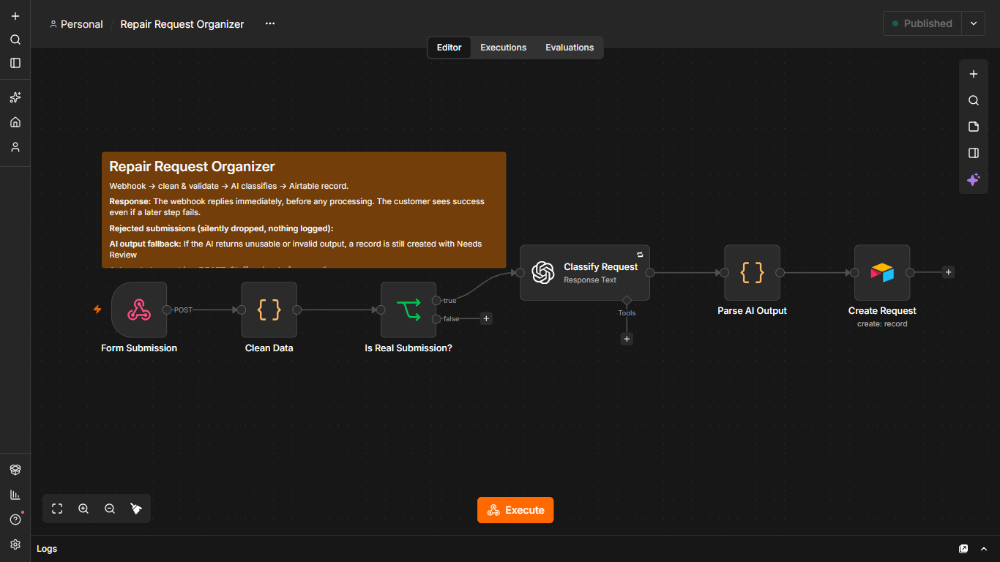
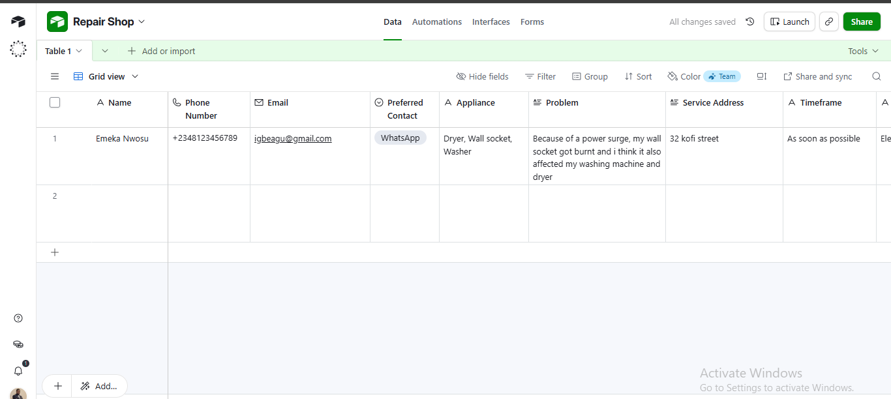
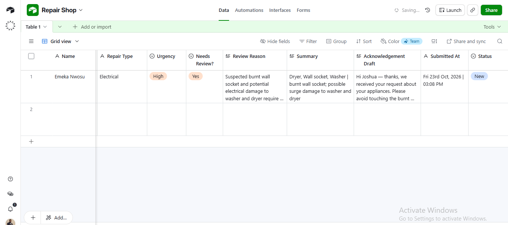

# Repair Request Organizer

An n8n workflow that converts appliance repair submissions into structured, prioritised Airtable records using AI-assisted classification, validation, and human review.

> **Project type:** Portfolio / Practice Project

## Overview

Appliance repair businesses receive requests with varying levels of detail, accuracy, and urgency. Manually reviewing and organising these submissions can create administrative overhead and make it harder to identify requests that need attention.

The Repair Request Organizer automates the initial intake and organisation process. It validates submitted information, uses GPT-5 mini to classify repair issues and assess urgency, flags requests requiring human attention, and stores the results in Airtable.

It also generates an acknowledgement draft for staff review. The workflow does not send messages to customers.

## Workflow

1. **Request intake:** Receives submissions through an n8n webhook.
2. **Data cleaning:** Normalises appliance names, trims input values, and prepares submitted data for validation.
3. **Submission validation:** Checks required fields, permitted contact methods, supported timeframes, and basic phone-number validity. Submissions that fail validation are rejected.
4. **AI classification:** GPT-5 mini identifies the repair category, assesses urgency, summarises the issue, and determines whether human review is required.
5. **Output validation:** A Code node checks the AI response against the expected structure, data types, permitted values, and review-reason rules.
6. **Fallback handling:** Invalid AI output is replaced with a fallback classification and a record marked for human review.
7. **Record creation:** Validated results and the acknowledgement draft are stored in Airtable.

### Workflow Overview


## Design Decisions and Safeguards

- **Untrusted customer input:** The AI instructions treat submitted text as data, not instructions. Suspected prompt injection is flagged for human review.
- **Structured output validation:** AI responses are checked in code before being passed to Airtable. The workflow does not rely solely on the model following its output instructions.
- **Fail toward human review:** Invalid AI output produces a fallback record requiring staff attention rather than silently accepting an unreliable classification.
- **Human control:** Acknowledgement messages are drafts. No customer-facing message is sent automatically.
- **Explicit urgency criteria:** High urgency requires a stated safety risk, an accruing loss, or a firm deadline within 48 hours. A customer's preferred service timeframe alone does not determine urgency.
- **Safety guidance constraints:** Safety guidance is limited to hazards explicitly mentioned in the submission.
- **Defined scope:** The front-end form is separate and not included. Duplicate-submission prevention is outside this workflow and is intended to be handled by the website server. Contact-detail validation is limited to basic checks, including a minimum phone-number length.

## Airtable Configuration

Create an Airtable table with the following fields. Field names and select options must match the workflow mappings.

| Field | Type / Options |
|---|---|
| Name | Single line text |
| Phone Number | Phone number or text |
| Email | Email or text |
| Preferred Contact | Single select: Phone call, WhatsApp, Email |
| Appliance | Long text |
| Problem | Long text |
| Service Address | Long text |
| Timeframe | Single line text |
| Repair Type | Single line text |
| Urgency | Single select: Low, Medium, High |
| Needs Review? | Single line text |
| Review Reason | Long text |
| Summary | Long text |
| Acknowledgement Draft | Long text |
| Submitted At | Date/time or text |
| Status | Single select: New, Contacted, Booked, Closed, Cancelled |

`Needs Review?` is stored as the text `Yes` or `No`
### Airtable Request Example



## Technology Stack

- **n8n:** Workflow automation and orchestration.
- **OpenAI GPT-5 mini:** Repair classification, urgency assessment, summarisation, and acknowledgement drafting.
- **Airtable:** Structured request storage and management.

## Setup

1. Create an Airtable base and table using the schema above.
2. Import `(repair-request-organizer.json)` into n8n.
3. Configure your own OpenAI credentials in the **Classify Request** node.
4. Configure your Airtable credentials in the **Create Request** node.
5. Replace the Airtable base and table placeholders with your own IDs.
6. Review the webhook response mode and configure it according to your deployment requirements.
7. Use a non-guessable webhook path, then test the workflow with valid, invalid, and edge-case submissions before deployment.

The exported workflow uses `gpt-5-mini`. Credentials and instance-specific identifiers are excluded from the repository.

## Failure Handling

| Scenario | Configured behaviour |
|---|---|
| Invalid or spam submission | Rejected at the validation branch; no Airtable record is created. |
| Invalid or unusable AI output | A fallback record is created and flagged for human review. |
| OpenAI request error | Retry is set for 3 times, with a 2-second wait between attempts. |
| Downstream failure after an immediate webhook response | The requester may already have received a successful response even if later processing fails. |

## Known Limitations

- **No webhook authentication or rate limiting:** Bot filtering and a honeypot provide limited protection. Anyone who obtains the webhook URL may attempt to submit requests. A non-guessable path reduces casual discovery but is not authentication.
- **Early webhook acknowledgement:** The webhook responds before downstream processing completes, a successful HTTP response does not confirm that the Airtable record was created.
- **Rejected submissions are not logged:** Requests that fail validation are dropped without creating a record or generating an alert. This can make legitimate submission failures difficult to investigate.
- **No duplicate detection:** Duplicate-submission prevention is not implemented in this workflow.
- **Limited contact validation:** Basic input checks do not establish whether a phone number or email address is genuine or reachable.
- **No automated customer communication:** Acknowledgement drafts require staff review and manual sending.

  

## Repository Structure

```text
repair-request-organizer/
├── workflow/
│   └── repair-request-organizer.json
├── docs/
│   └── images/
│       ├── workflow-canvas.png
│       └── airtable-record.png
└── README.md
```

Screenshots are included to demonstrate the workflow structure and an example Airtable record.
