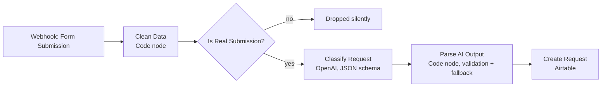

# Repair Request Organizer

An n8n workflow that turns free-text appliance repair requests into structured, triaged Airtable records, with an AI-drafted acknowledgement that staff review before anything is sent.

> **Status: practice project.** Built against a fictional business ("Relay Appliance Repair") with test data. It is not a client deployment and has no production usage history.

## The problem

Repair requests arrive as free text: *"the fridge is leaking"*, *"my oven smells like it's burning"*, *"it's not working"*. Before anyone can act, staff have to read each one, work out what is wrong, decide what is urgent, and draft a reply.

## What the workflow does



1. **Form Submission (Webhook, POST).** Receives the request. Replies immediately, before processing. Bot filtering is enabled on the node.
2. **Clean Data (Code).** Trims and length-limits every field, de-duplicates and sorts the appliance list, validates the required fields, and checks a honeypot field.
3. **Is Real Submission? (IF).** Valid submissions continue; rejected ones stop here.
4. **Classify Request (OpenAI).** Returns repair type, urgency, a needs-review flag with a reason, a short staff summary, and a draft acknowledgement. Output is constrained by a JSON schema. Retry on failure is enabled (2 second wait).
5. **Parse AI Output (Code).** Validates the AI response against the allowed values and consistency rules. If it is missing or invalid, it builds a fallback record (`Other / unknown`, `Medium`, needs review = Yes, empty acknowledgement) instead of dropping the request.
6. **Create Request (Airtable).** Writes one record with status `New`.

## Design decisions

- **Customer text is untrusted input.** The prompt tells the model to treat submission values as data, ignore instructions inside them, and flag suspected injection for human review.
- **The AI output is validated in code, not trusted.** Enum values, types, and the rule "review reason must be empty when needs review is false (and non-empty when true)" are checked before anything is written.
- **Fail toward a human.** Invalid AI output produces a flagged fallback record. Vague, contradictory, unsafe, or manipulative requests are flagged for review.
- **Humans stay in control.** The acknowledgement is a draft. Nothing is sent to the customer by this workflow.
- **Urgency rules are explicit.** High urgency requires a stated safety risk, a stated accruing loss, or a stated deadline within 48 hours. The customer's requested timeframe alone does not make a request urgent.
- **Safety guidance is limited to hazards the customer actually mentions.**
- **Deliberately out of scope:** the front-end form (it is a separate project and is not included here), duplicate-submission prevention (intended to be handled by the website server), and contact-detail validation beyond a minimum phone length.

## Webhook contract

The form itself is not part of this repo, so this is the contract any client must follow. Send a `POST` with a JSON body:

| Field | Type | Required | Rules |
|---|---|---|---|
| `name` | string | yes | Trimmed, max 100 chars |
| `number` | string | yes | At least 7 digits; max 30 chars stored |
| `email` | string | no | Max 200 chars. **Not format-validated** |
| `preferred_contact` | string | yes | One of `WhatsApp`, `Phone call`, `Email` |
| `appliance` | string[] or comma-separated string | yes | At least one; de-duplicated, max 12 items, 60 chars each |
| `problem` | string | yes | Max 2000 chars |
| `service_address` | string | no | Max 300 chars |
| `timeframe` | string | yes | One of `As soon as possible`, `Within a week`, `Next week` |
| `submitted_at` | string | no | Stored as supplied by the client |
| `website` | string | honeypot | Must be empty or absent; any value rejects the submission |

Sample requests are in [`docs/sample-payloads.md`](docs/sample-payloads.md).

## Airtable schema

Create a table with these fields (the workflow maps to them by name):

`Name`, `Phone Number`, `Email`, `Preferred Contact` (single select: Phone call / WhatsApp / Email), `Appliance`, `Problem`, `Service Address`, `Timeframe`, `Repair Type`, `Urgency` (single select: Low / Medium / High), `Needs Review?`, `Review Reason`, `Summary`, `Acknowledgement Draft`, `Submitted At`, `Status` (single select: New / Contacted / Booked / Closed / Cancelled).

`Needs Review?` is written as the text `Yes` or `No`.

## Setup

1. Create the Airtable table above.
2. In n8n, import `workflow/repair-request-organizer.json`.
3. Attach your own credentials to the **Classify Request** (OpenAI) and **Create Request** (Airtable) nodes. The export contains no credentials.
4. Set the Airtable base and table on **Create Request** (the file contains placeholders).
5. Change the webhook path to something non-guessable, then publish the workflow and POST a sample payload.

The model configured in the export is `gpt-5-mini`.

## Failure handling

| Situation | Behaviour (from the workflow's configuration) |
|---|---|
| Invalid or spam submission | Dropped at the IF node. Nothing is logged. |
| AI returns invalid or unusable output | Fallback record created, flagged for review |
| OpenAI call errors | Retried once with a 2 second wait (n8n retry setting) |
| Later step fails after the webhook has replied | Customer has already seen success |

## Known limitations

These are things I know the workflow does not do. They are listed so nobody assumes otherwise.

- **No webhook authentication or rate limiting.** Bot filtering and a honeypot are the only protections. Anyone with the URL can post to it.
- **Rejected submissions leave no trace.** A real customer who fails validation is dropped without a record or alert.
- **If OpenAI is still failing after retries, the request is lost** from Airtable. The fallback record only covers invalid *output*, not a failed *call*. The same applies to an Airtable write failure. No failure alerting is included in this repo.
- **Prompt rules that code does not enforce.** Word limits, banned phrases, and the sign-off line in the acknowledgement are instructed in the prompt but not checked in code. Staff review of the draft is the control.
- **`preferred_contact = Email` with no email is accepted.**
- **`submitted_at` is client-supplied**, not server time.
- **No duplicate prevention in this workflow.**
- **Personal data** (names, phones, addresses) is written to Airtable with no retention policy.

## Testing

> **TODO before publishing:** replace this section with your real results. Do not publish with the placeholder.

| # | Input (summary) | Expected | Actual | Pass/Fail |
|---|---|---|---|---|
| 1 | | | | |

Not yet tested: *(list the scenarios you did not run)*

## Repo layout

```
README.md
workflow/repair-request-organizer.json
docs/sample-payloads.md
docs/images/            (canvas screenshot, Airtable record screenshot)
```
